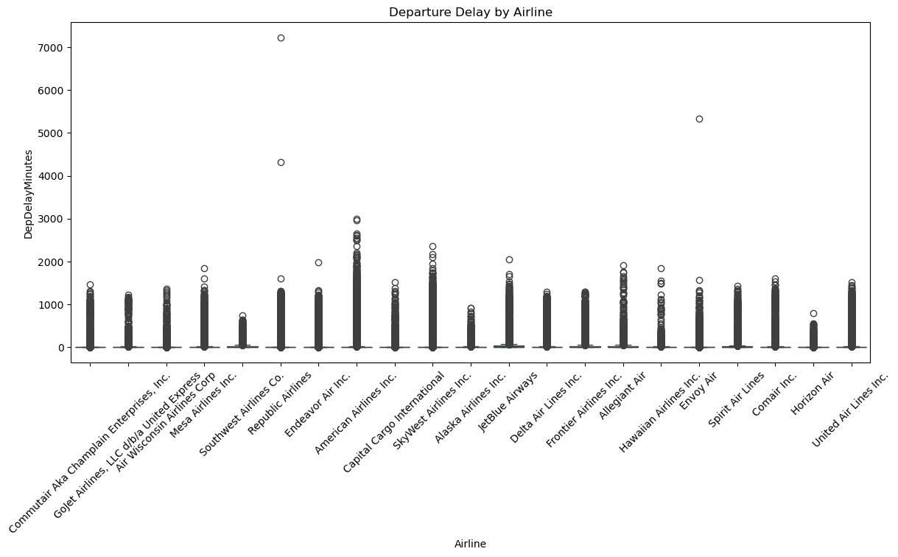
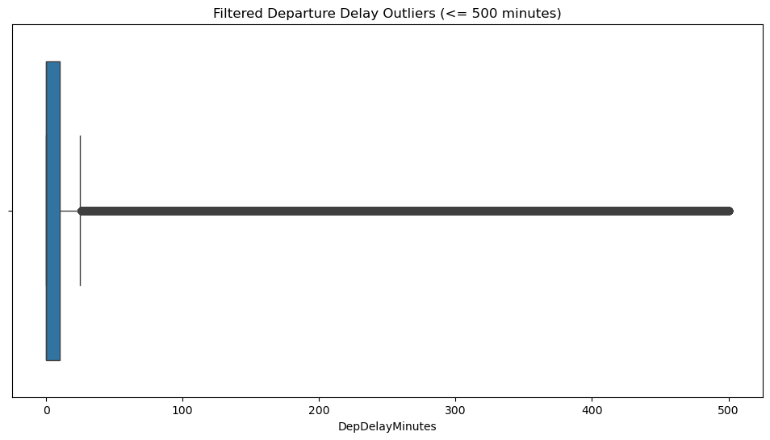
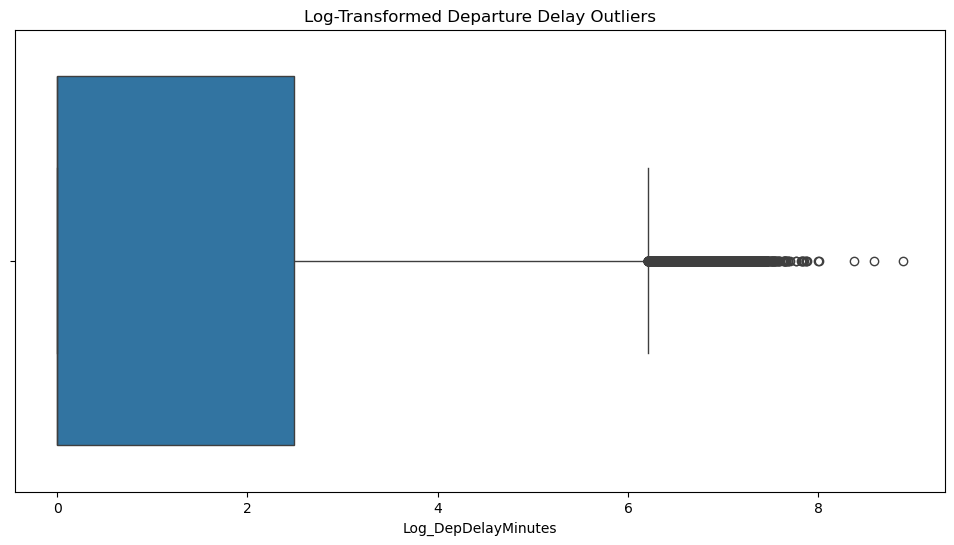
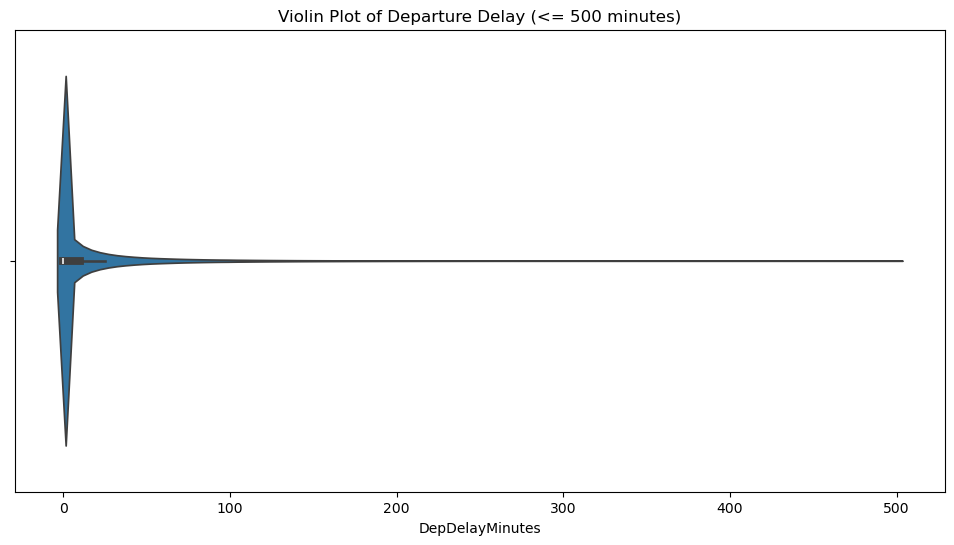
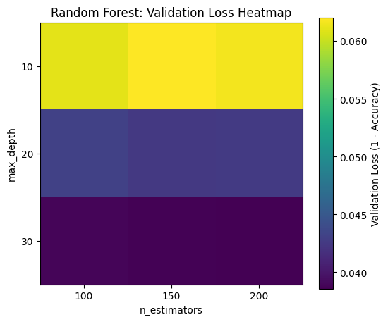
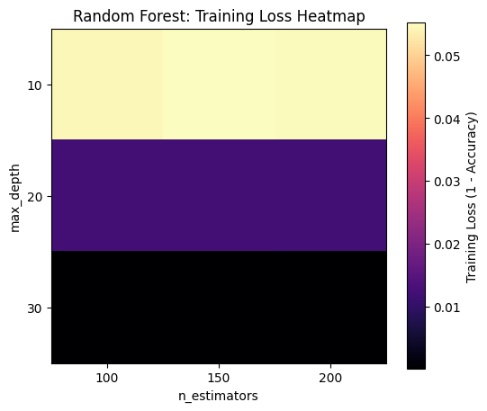
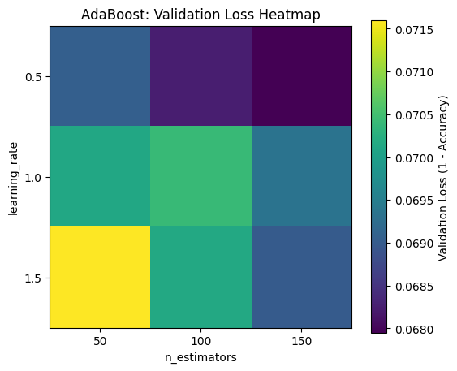
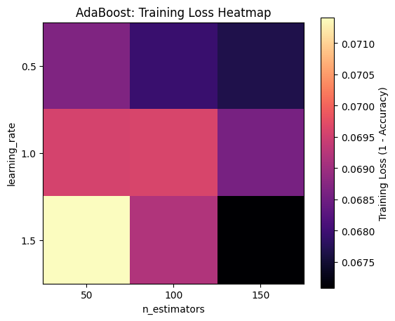

# Project Report — Flight Status Prediction

This document provides the extended visual walkthrough for the project. It is intentionally implementation-free: the focus is on the data, modeling logic, results, and interpretation.

## 1. Objective

The task is to classify whether a U.S. domestic flight arrives more than 15 minutes late. The binary target is `ArrDel15`.

The analysis begins with the 2022 portion of a larger 2018–2022 Kaggle flight dataset. The raw 2022 file contains 4,078,318 rows and 61 columns.

## 2. Exploratory Analysis

### 2.1 Busiest origin airports

The full 2022 data were first used to rank origin airports by flight volume.

### 2.2 Delay behavior by month

Average delay rises during busier summer months in the analyzed period.

### 2.3 Delay behavior by time of day

Delay is lowest in the early morning and generally increases through the day, peaking during late-afternoon and evening periods.

### 2.4 Delay behavior by weekday

The weekday distribution shows non-uniform delay behavior, supporting the use of temporal variables.

### 2.5 Operational correlation structure

Strong relationships appear between several operational variables. These include the expected connection between air time and distance, and between departure and arrival delay indicators.

## 3. Modeling Sample

The exploratory notebook identifies the top ten origin airports across 2022. For the subsequent modeling pipeline, the implementation narrows the dataset to **ATL-origin flights**, leaving 183,697 records before final preparation.

After preprocessing and dropping rows without the target/departure-delay indicator, the prepared dataset contains **179,852 rows**.

The target is imbalanced: approximately 80.3% are class 0 and 19.7% are class 1.

## 4. Preprocessing and Feature Engineering

The raw modeling table is reduced to the following conceptual groups:

- taxi and airborne operations;
- calendar variables;
- distance and air time;
- airline;
- scheduled and actual clock-time variables;
- departure-delay indicator;
- arrival-delay target.

Five HHMM time fields are converted into circular sine/cosine components. This representation preserves daily periodicity and avoids treating midnight as numerically distant from 23:59.

Numeric predictors are mean-imputed and standardized. Categorical values are imputed using the most frequent category and one-hot encoded.

## 5. Additional EDA Diagnostics

### 5.1 Departure delay by airline

The airline-level boxplot demonstrates heavy right tails and substantial outliers.

### 5.2 Outlier-focused views

These views reinforce the highly skewed nature of delay duration.

## 6. Baseline Classification

Eight baseline classifiers were compared using validation accuracy.

XGBoost achieved the highest baseline validation accuracy at 97.21%.

### Confusion matrices

The confusion matrices show that models with similar overall accuracy can differ meaningfully in their treatment of delayed flights.

## 7. Hyperparameter Tuning

Five-fold GridSearchCV was used to explore model settings. The report's selected XGBoost configuration was:

- learning rate: 0.2
- maximum depth: 9
- estimators: 200

The tuning stage improved XGBoost and SVM, while some configurations for Decision Tree and Random Forest underperformed their baseline settings.

### Logistic Regression complexity curve

### Decision Tree complexity curve

### Random Forest grid diagnostics

| Validation loss | Training loss |
|---|---|
|  |  |

### AdaBoost grid diagnostics

| Validation loss | Training loss |
|---|---|
|  |  |

## 8. Tuned XGBoost

The tuned model produced the following confusion matrix on a 26,978-row evaluation split:

| Metric | Value |
|---|---:|
| Accuracy | 97.75% |
| Delay precision | 94.90% |
| Delay recall | 93.66% |
| Delay F1-score | 94.28% |
| True negatives | 21,380 |
| False positives | 268 |
| False negatives | 338 |
| True positives | 4,992 |

### ROC analysis

### Learning curve

The training curve remains near 1.0 while the validation curve approaches the upper 0.97 range, indicating a persistent but relatively small generalization gap.

## 9. Overfitting-Mitigation Experiment

A later experimental configuration used shallower trees, row and feature subsampling, L1/L2 regularization, and early stopping. The objective was to reduce the strong training fit observed in the selected tuned model.

The notebook records a 95.18% test accuracy for this more strongly regularized experiment. Because the project report uses the 97.75–97.78% tuned XGBoost result as the headline model, this later configuration is presented here as an auxiliary robustness experiment rather than replacing the main reported result.

## 10. Computational Comparison

XGBoost offered a strong speed/accuracy balance in the reported comparison.

## 11. Interpretation

The project demonstrates a complete classification workflow: exploratory analysis, feature reduction, cyclical time engineering, preprocessing, baseline comparison, cross-validated tuning, and multi-metric evaluation.

The high predictive scores are partly explained by the use of operational variables that are closely related to arrival delays. For a strict pre-departure prediction system, target-time availability must be enforced: variables such as actual departure status, taxi movements, and wheel-off/wheel-on timings should only be used if they are genuinely available at the intended prediction moment.

## 12. Next Steps

A stronger forecasting-oriented extension would:

1. define a fixed prediction time such as 2 hours before scheduled departure;
2. retain only features known at that time;
3. add weather, airport congestion, and air-traffic-control indicators;
4. use chronological validation rather than random splitting;
5. compare calibration and PR-AUC in addition to ROC-AUC;
6. evaluate performance separately by airport, airline, season, and delay prevalence.

